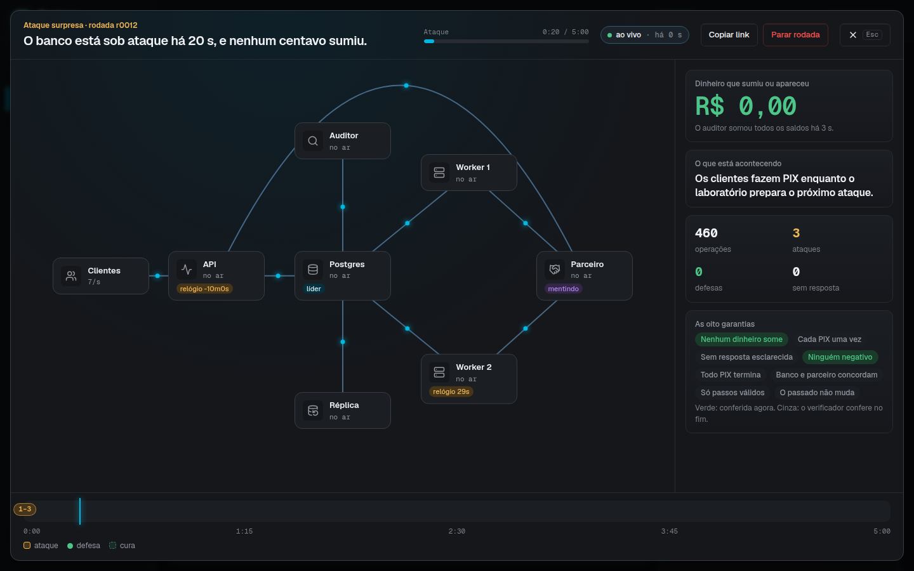
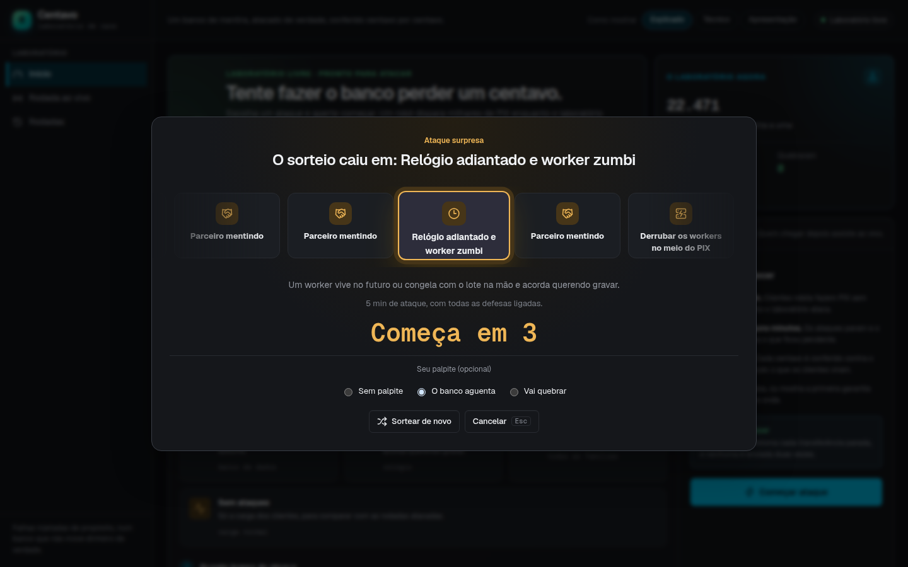

# Centavo

[](https://github.com/MatheusZuchiBalbinot/centavo/actions/workflows/ci.yml)
[](LICENSE)

Um banco digital pequeno, escrito em Go, feito para ser atacado. Clientes
robôs abrem contas, depositam, transferem entre si e mandam e recebem PIX sem
parar. Enquanto isso, um laboratório de caos mata processos no meio de uma
escrita, corta e atrasa a rede, faz o banco parceiro mentir, congela workers,
adianta relógios e troca o banco de dados de líder. No fim de cada rodada, um
verificador lê o histórico de tudo o que os clientes viram e o banco inteiro,
e diz se algum centavo sumiu, apareceu ou foi lançado duas vezes.

O PIX é simulado. O banco parceiro é um serviço do próprio projeto que segue
o formato do PIX (`end_to_end_id`, chave de destino, liquidação, devolução e
webhooks), com uma base própria e um modo em que mente de propósito: liquida
o mesmo PIX duas vezes, responde timeout depois de processar, repete webhooks
ou manda fora de ordem.

Um painel em React acompanha a rodada ao vivo. O mapa do sistema mostra cada
ataque caindo no processo ou na conexão que ele atingiu, e logo depois a
defesa que respondeu. Ao lado, um auditor soma todos os saldos por fora do
banco a cada 2 segundos. Uma rodada terminada pode ser vista de novo em
replay, a até 60 vezes a velocidade real.



## O que o projeto demonstra

Os bugs que fazem um banco perder dinheiro aparecem nas bordas: o processo
morre entre o débito e o crédito, o commit acontece e a resposta se perde, o
parceiro responde timeout e mesmo assim processa. Cada defesa do banco cobre
um desses casos e tem um nome, para que dê para desligá-la e ver a falha
voltar:

- Ledger de partidas dobradas: todo lançamento soma zero, e o saldo de cada
  conta é a soma dos seus lançamentos (`atomic_ledger`).
- Locks de linha tomados sempre na mesma ordem, para que duas transferências
  em sentidos opostos não se travem nem gastem o mesmo saldo
  (`balance_locking`).
- Idempotência de ponta a ponta. A mesma chave devolve a mesma resposta,
  inclusive para o cliente que perdeu a primeira e tentou de novo, e cada PIX
  leva um `end_to_end_id` fixo, que não muda quando o envio é repetido
  (`idempotency`, `partner_idempotency`).
- Outbox e inbox. O PIX de saída é gravado na transação do débito e enviado
  depois, e um webhook repetido do parceiro não faz nada (`outbox`, `inbox`).
- Máquina de estados do PIX, que só aceita passos válidos e confere o status
  direto no parceiro antes de confiar num webhook (`state_machine`).
- Um sweeper que consulta o parceiro e retoma os PIX parados no meio do
  caminho (`recovery`).
- Cliente HTTP com timeout por tentativa, backoff com jitter e circuit
  breaker. Um timeout nunca vira falha (`resilient_client`).
- Conciliação com o extrato do parceiro, que corrige e registra cada
  divergência (`reconciliation`).
- Leases com fencing tokens. Um worker congelado que acorda achando que ainda
  é o dono do trabalho tem a escrita recusada (`fencing`).
- Commit síncrono e replicação síncrona antes de um failover (`durable_db`).

O verificador confere oito garantias contra o histórico: nenhum dinheiro some
nem aparece, cada operação acontece uma vez, respostas perdidas são
esclarecidas, nenhum cliente fica negativo, toda transferência termina, o
banco concorda com o parceiro, só há passos válidos e o passado não muda.
Quando uma garantia quebra, o relatório aponta a primeira violação e o
comando para reproduzir a rodada com a mesma semente.

O laboratório não importa nenhum código do banco nem do parceiro, e o binário
de produção do banco é compilado sem o código de caos. As duas coisas são
conferidas no CI. São 250 testes em Go (os do banco rodam contra um
PostgreSQL real com testcontainers) e 94 no painel, com verificação de
acessibilidade.

## Uma rodada

1. Na página inicial, escolha um ataque e uma duração, ou aperte "Ataque
   surpresa" para sortear os dois.
2. A arena abre em tela cheia. Por 3, 5 ou 10 minutos, os clientes robôs
   operam enquanto o laboratório ataca.
3. A cura desliga todas as falhas e espera o banco terminar o que ficou
   pendente.
4. O verificador confere o histórico e carimba o veredito: passou, quebrou ou
   inconclusiva.



## Rodar

Precisa de Docker com Compose v2.

```sh
git clone https://github.com/MatheusZuchiBalbinot/centavo.git
cd centavo
./entrypoint.sh
```

O `entrypoint.sh` confere o Docker e a porta 8090, gera um `.env` com senhas
aleatórias, constrói as imagens e espera todos os serviços ficarem saudáveis.
A primeira vez leva alguns minutos. Depois, o painel fica em
<http://localhost:8090>.

Para parar, `docker compose down`. Os dados ficam no volume e voltam na
próxima subida.

## Desenvolver

O Go é baixado na versão dos `go.mod`. O painel fica em `lab/web`.

| Comando | O que faz |
| --- | --- |
| `make test` | testes dos três módulos, com e sem o código de caos |
| `make lint` | golangci-lint nos dois builds |
| `make fmt` | formata o código |
| `make check` | confere que o laboratório não importa o banco e que o binário de produção não tem código de caos |

## Estrutura

- `bank/`: o banco, com uma API HTTP e workers sobre PostgreSQL.
- `partner/`: o banco parceiro que liquida os PIX, sobre SQLite.
- `lab/`: o gerador de carga, o laboratório de caos, o auditor, o
  verificador e o painel.

## Licença

MIT.
