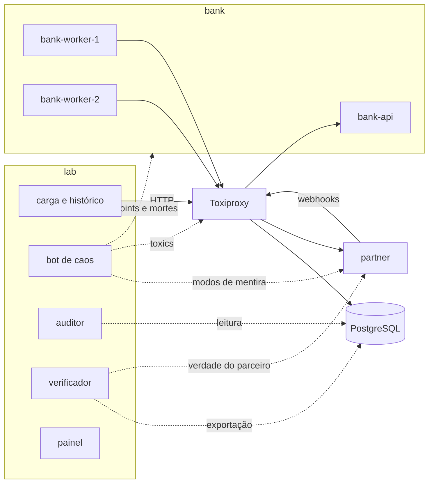

# Como o Centavo funciona

O Centavo testa se um banco pequeno, escrito com as técnicas certas,
atravessa falhas de verdade sem perder um centavo. Para isso, o projeto tem
três partes que não confiam umas nas outras. O banco
faz o trabalho. Um laboratório ataca o banco enquanto ele trabalha. Um
verificador lê o que aconteceu e decide se o dinheiro fecha.

A resposta é empírica, no espírito do Jepsen. "Zero violações" vale para as
rodadas observadas, com os cenários e as sementes registrados. É evidência e
não prova formal.

## O problema

Os bugs que fazem um banco perder dinheiro aparecem nas bordas:

- o processo morre entre o débito e o crédito;
- o commit acontece, a resposta se perde e o cliente tenta de novo;
- o parceiro responde timeout, mas processou;
- o webhook chega duas vezes, atrasado e fora de ordem;
- o failover promove uma réplica que não tinha as últimas escritas;
- um worker pausado acorda achando que ainda é o dono do trabalho.

Cada uma dessas falhas é rara sozinha e certa em escala. O laboratório existe
para torná-las frequentes, reproduzíveis e visíveis.

## As peças

O `bank` é um monólito modular em Go sobre PostgreSQL, que roda como dois
papéis de processo: a API HTTP e dois workers. Os workers enviam os PIX de
saída, aplicam os webhooks do parceiro, retomam o que ficou parado e
conciliam o extrato. Ele tem contas, depósito, transferência entre contas,
extrato paginado, PIX de saída assíncrono e PIX de entrada.

O `partner` é o banco parceiro que liquida os PIX, em Go e SQLite. O PIX é
simulado, mas segue o formato real: `end_to_end_id`, chave de destino,
liquidação, devolução depois de liquidado e webhooks assinados. O parceiro
tem um modo em que mente nas respostas e nas entregas: responde timeout
depois de processar, liquida o mesmo PIX duas vezes, repete, atrasa, reordena
ou perde webhooks, ou sai do ar. A verdade dele, o que realmente processou,
nunca mente, e é a referência externa do verificador.

O `lab` junta o gerador de carga, o bot de caos, o auditor ao vivo, o
verificador e o painel. Ele não importa nenhum código do banco nem do
parceiro, e o CI confere isso.

Todo o tráfego entre as peças passa pelo Toxiproxy, que é onde o bot injeta
latência, partições e conexões cortadas. Uma réplica do PostgreSQL sobe só
nos cenários de failover.

## Uma rodada

1. Preparação: o laboratório cura qualquer resto da rodada anterior, confere
   a saúde de tudo, cria as contas da rodada e abastece com depósitos.
2. Carga e caos: clientes robôs depositam, transferem, mandam PIX, pedem PIX
   de entrada ao parceiro e leem saldos e extratos, enquanto o bot segue o
   roteiro do cenário. Cada pedido é gravado no histórico, com `fsync`, antes
   de sair.
3. Cura: o bot desliga tudo, remove os toxics, limpa failpoints e relógios,
   põe o parceiro em modo honesto, descongela e religa os processos, e espera
   todos ficarem saudáveis.
4. Quiescência: a carga para, e o laboratório espera as transferências
   terminarem e a outbox e a inbox esvaziarem.
5. Leituras finais: cada operação que ficou sem resposta é resolvida, o
   saldo final de cada conta é lido e uma conciliação final roda.
6. Verificação: o laboratório exporta o ledger e a verdade do parceiro, e o
   verificador roda num subprocesso com limite de memória.

Uma rodada tem uma semente. A mesma semente reproduz a mesma carga e a mesma
agenda de falhas. A intercalação exata muda a cada execução, porque depende
do escalonador e da rede, então a reprodução exata de um bug é um teste de
regressão que força a janela dele.

## Os ataques

O bot tem 28 cenários com nome, que o painel agrupa em seis ataques e uma
rodada sem ataques, para comparação. Cada família de falha entra por um
caminho diferente:

- Morte em ponto exato: failpoints nomeados no código do banco, como
  `recon.after_compute_before_apply`, matam o processo entre duas escritas ou
  entre uma escrita e um efeito externo.
- Morte aleatória: o bot roda `chaos-kill` dentro do contêiner, que manda
  `SIGKILL` no processo principal. O `docker kill` seria tratado pelo Docker
  como parada manual, e a política de reinício não traria o processo de volta.
- Rede: toxics do Toxiproxy para latência, blackhole, conexão resetada,
  resposta cortada no meio e partições que deixam a requisição chegar e a
  resposta não voltar.
- Parceiro mentiroso: modos com probabilidade e prazo de validade, configurados
  na API de caos do parceiro.
- Banco de dados: morte do postmaster ou de um backend, congelamento com
  `docker pause` e failover para a réplica.
- Relógio: um deslocamento somado ao relógio de parede da aplicação. O
  libfaketime não serve para binários Go estáticos, e mudar o relógio do host
  afetaria o PostgreSQL também.
- Processo congelado: `docker pause` num worker que segura um lease, para que
  ele acorde depois que outro já assumiu.

Toda configuração de caos tem prazo de validade, renovado enquanto a rodada
dura. Se o laboratório morrer, o caos para sozinho.

Quem assiste a uma rodada ao vivo também pode atacar, enquanto durar a fase de
ataque. Na arena, um clique num processo ou numa conexão abre o que aconteceu
ali e os botões: derrubar o processo, congelá-lo por 20 segundos, cortar a
conexão por 15 ou deixá-la lenta por 20. O pedido vira um arquivo na pasta da
rodada, o bot o executa com as mesmas ferramentas do roteiro e grava no
histórico que o ataque foi manual. O verificador confere a rodada do mesmo
jeito, e o relatório conta os ataques manuais à parte: a semente repete os do
cenário, não os feitos à mão. São no máximo 12 ataques por minuto, para que
ninguém segure o banco no chão a rodada inteira.

## As defesas

Cada técnica do banco é uma defesa com nome. O perfil `robust` liga todas, e
`CENTAVO_DEFENSES=robust,-fencing` desliga uma. A variante ingênua de cada
defesa só existe no build de laboratório, então dá para rodar o mesmo
cenário com a mesma semente com e sem a defesa e ver uma rodada passar e a
outra quebrar.

- `atomic_ledger`: ledger de partidas dobradas. Todo lançamento soma zero, e
  o saldo de cada conta é a soma dos seus lançamentos. Correção é estorno,
  nunca `UPDATE`.
- `balance_locking`: locks de linha tomados sempre na mesma ordem, para que
  duas transferências em sentidos opostos não se travem nem gastem o mesmo
  saldo.
- `idempotency`: a chave nasce no cliente e é gravada no mesmo commit do
  efeito. A mesma chave devolve a mesma resposta, e uma lápide impede que um
  pedido atrasado aplique depois de resolvido.
- `outbox`: o PIX de saída é gravado na transação do débito e enviado
  depois. Nada sai do banco que não esteja gravado nele.
- `inbox`: um webhook repetido do parceiro não faz nada.
- `partner_idempotency`: cada PIX tem um `end_to_end_id` fixo, que não muda
  quando o envio é repetido.
- `state_machine`: o PIX só aceita passos válidos, e o banco confere o status
  direto no parceiro antes de confiar num webhook.
- `recovery`: um sweeper consulta o parceiro e retoma os PIX parados no meio.
- `resilient_client`: timeout por tentativa, backoff com jitter e circuit
  breaker. Um timeout nunca vira falha: o banco só declara falha diante de uma
  recusa do parceiro.
- `reconciliation`: conciliação com o extrato do parceiro, que corrige e
  registra cada divergência.
- `fencing`: leases com fencing tokens. Um worker que perdeu o lease tem a
  escrita recusada, mesmo que ache que ainda é o dono.
- `durable_db`: commit síncrono e replicação síncrona antes de um failover.

Leases, expirações e ordenação usam o relógio e as sequências do PostgreSQL,
nunca o relógio de um processo. Por isso o ataque de relógio não consegue
roubar um lease com as defesas ligadas.

## O verificador

O verificador cruza três fontes que não dependem umas das outras:

- o histórico, com tudo o que os clientes pediram e receberam;
- a exportação do ledger, lida por um papel só de leitura do PostgreSQL,
  numa transação `REPEATABLE READ`;
- a verdade do parceiro.

Ele recalcula tudo a partir dos lançamentos e não confia em nenhum saldo
guardado pelo banco. As oito garantias:

| | Garantia | O que confere |
| --- | --- | --- |
| I1 | Nenhum dinheiro some nem aparece | cada transação soma zero, cada saldo bate com os lançamentos, e o dinheiro em trânsito fecha com o parceiro |
| I2 | Cada operação acontece uma vez | o que o cliente viu confirmado foi aplicado exatamente uma vez, e o que foi recusado, nunca |
| I3 | Respostas perdidas são esclarecidas | uma operação sem resposta foi aplicada no máximo uma vez, e o banco diz a verdade quando perguntado |
| I4 | Nenhum cliente fica negativo | nenhum saldo de cliente fica abaixo de zero, nem por um instante |
| I5 | Toda transferência termina | depois da cura, nenhum PIX fica preso no meio |
| I6 | O banco concorda com o parceiro | o que o banco liquidou, devolveu e creditou é o que o parceiro diz que fez |
| I7 | Só passos válidos | cada transferência segue a máquina de estados, com um lançamento por passo |
| I8 | O passado não muda | os lançamentos de rodadas anteriores continuam idênticos |

Uma operação sem resposta (timeout, conexão cortada) nunca conta como falha.
No fim da rodada, o laboratório pergunta ao banco o que aconteceu com cada
uma, e a resposta é "aplicada" ou "anulada", com uma lápide que impede
mudança depois. Se algo não pode ser esclarecido, a rodada fica inconclusiva
em vez de reprovada.

Quando uma garantia quebra, o relatório aponta a primeira violação e monta o
caminho de falhas: os registros da operação, os ataques e eventos na mesma
janela de tempo e as linhas do ledger e do parceiro envolvidas. O relatório
termina com o comando para repetir a rodada com a mesma semente.

Um verificador que nunca reprova é tratado como quebrado. Um teste de mutação
altera a exportação de propósito, e o CI exige que cada mutação seja pega
pela regra certa.

## O painel

O painel é React e TypeScript, servido pelo próprio laboratório. Uma rodada
ao vivo chega por Server-Sent Events: o histórico segundo a segundo, cada
ataque, cada defesa que o banco registrou e cada mudança de estado dos
processos, como um worker caindo e voltando.

A arena reconstrói o estado do sistema a partir desses eventos, e o replay
usa a mesma arena com o relógio controlado pelo player. Ela liga cada ataque
à primeira defesa que veio depois dele e mede quanto o alvo levou para voltar,
pelos estados dos processos que o laboratório registra. No pé da arena, as
ocorrências põem cada ataque, cada defesa e cada transferência num ponto com a
cor do seu tipo. O replay guarda cada transferência com as contas, o valor, o
resultado e o tempo de resposta, e a rodada ao vivo as manda aos poucos pelo
mesmo stream dos eventos. O painel tem três
modos de linguagem (explicado, técnico e apresentação), glossário em
tooltips, som opcional e um placar das rodadas. Ele segue a WCAG 2.2 AA: tudo
funciona pelo teclado, e os testes das páginas rodam o axe.

As telas estão no [showcase](../showcase/README.md).

## Como foi feito

O projeto foi construído em ciclos, sempre com o mesmo roteiro: uma versão
ingênua de propósito roda sob ataque, o verificador acha a primeira violação,
o bug vira um postmortem, a defesa entra com nome e flag, e um teste de
regressão força a mesma janela de falha. O teste falha com a defesa desligada
e passa com ela ligada.

Foram 17 postmortems de bugs que o laboratório achou de verdade. Alguns não
estavam previstos. O primeiro failover com replicação síncrona perdeu um
depósito confirmado: o cliente desistiu enquanto o commit esperava a réplica,
o cancelamento da requisição cancelou a espera, e o PostgreSQL manteve o
commit só no primário. O retry achou a chave de idempotência concluída e
devolveu a resposta guardada sem escrever nada, e o failover levou a linha.
A correção fez toda resposta repetida reescrever a linha da chave antes de
responder, para que a resposta só saia depois que o original chegou à
réplica. Outro postmortem foi de deadlocks no próprio banco robusto, que
travavam a conciliação final, e a correção centralizou a ordem dos locks.

Algumas decisões de estrutura:

- O banco segue camadas: handlers HTTP, casos de uso, domínio e
  infraestrutura. A aplicação declara interfaces pequenas por caso de uso, e
  só os repositórios tocam o SQL, com modelos de linha e um construtor de
  consultas pequeno, sempre com argumentos nomeados.
- As regras de negócio vivem no domínio, e as constraints do PostgreSQL são a
  rede de segurança: um bug de aplicação não vira dinheiro perdido.
- O código de caos (failpoints, servidor de caos, variantes ingênuas e
  `chaos-kill`) só existe com a build tag `chaoslab`. O binário de produção é
  compilado sem ela, e o CI inspeciona o binário para garantir.
- As portas de caos ficam na rede interna do Compose, toda chamada de caos
  exige um token, e o bot fala com o Docker por um proxy que só permite
  algumas ações e só em contêineres marcados como alvo.

## Testes e CI

São mais de 260 testes em Go. Os do banco rodam contra um PostgreSQL real com
testcontainers, e há testes baseados em propriedades (rapid) para o ledger e
fuzzing no validador do histórico. O painel tem mais de 110 testes, com
verificação de acessibilidade.

O CI roda `go vet`, testes com `-race`, um piso de cobertura e golangci-lint
nos dois builds de cada módulo, govulncheck, `npm audit`, os testes do painel, a construção
das imagens de produção e de laboratório, as travas de isolamento e, por
fim, sobe o laboratório inteiro com o `entrypoint.sh` e espera tudo ficar
saudável.

## O que ainda falta

Experimentos com o AWS FIS e uma rodada longa, de dias, com os dados brutos
publicados.
