# Showcase

As telas do painel do Centavo, capturadas de rodadas reais do laboratório. A
r0012 aparece na página do resultado e no replay, e o sorteio é o que criou a
r0028. A arena ao vivo é da r0027, uma rodada de rede caindo e voltando em
que também houve ataques feitos à mão. Todas as rodadas mostradas passaram,
com as oito garantias mantidas.

## Início

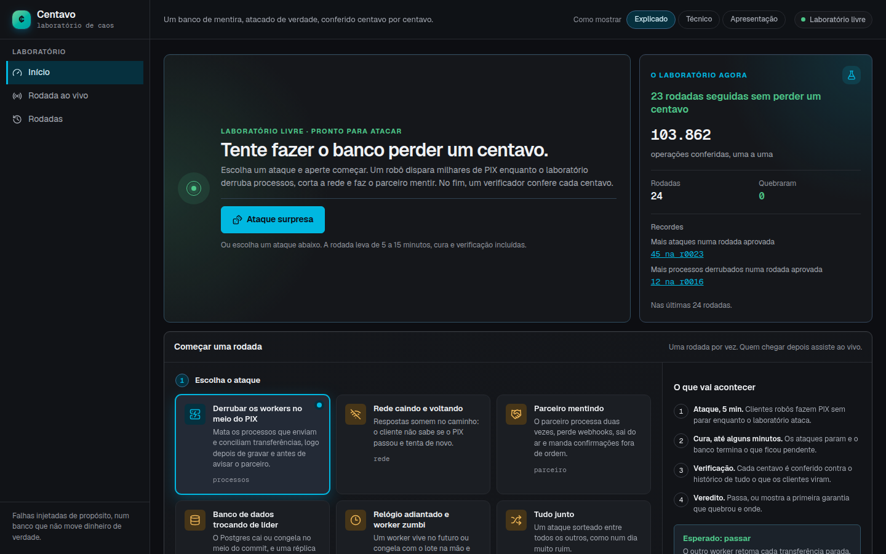

A página inicial convida a tentar fazer o banco perder um centavo. Dá para
escolher um dos seis ataques e a duração, ou apertar "Ataque surpresa". Ao
lado, o cartão do laboratório mostra a sequência atual (23 rodadas seguidas
sem perder um centavo), as operações conferidas nas últimas rodadas e os
recordes, como o de ataques numa rodada aprovada: 45, na r0023, com link para
ela.

## O sorteio

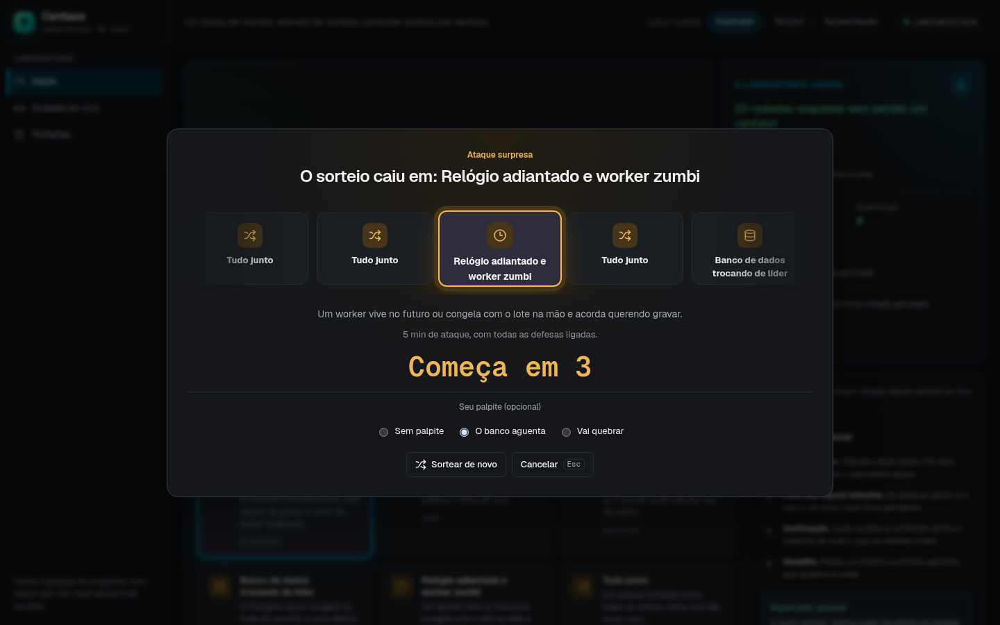

O ataque surpresa gira uma roleta com os ataques do cardápio e para em um.
Aqui caiu em "Relógio adiantado e worker zumbi", com 5 minutos, e virou a
r0028. A duração também é sorteada. Antes da contagem de 3 segundos, dá para
deixar um palpite: o banco aguenta ou vai quebrar. O palpite fica guardado no
navegador, e o veredito diz se ele acertou.

## A arena ao vivo

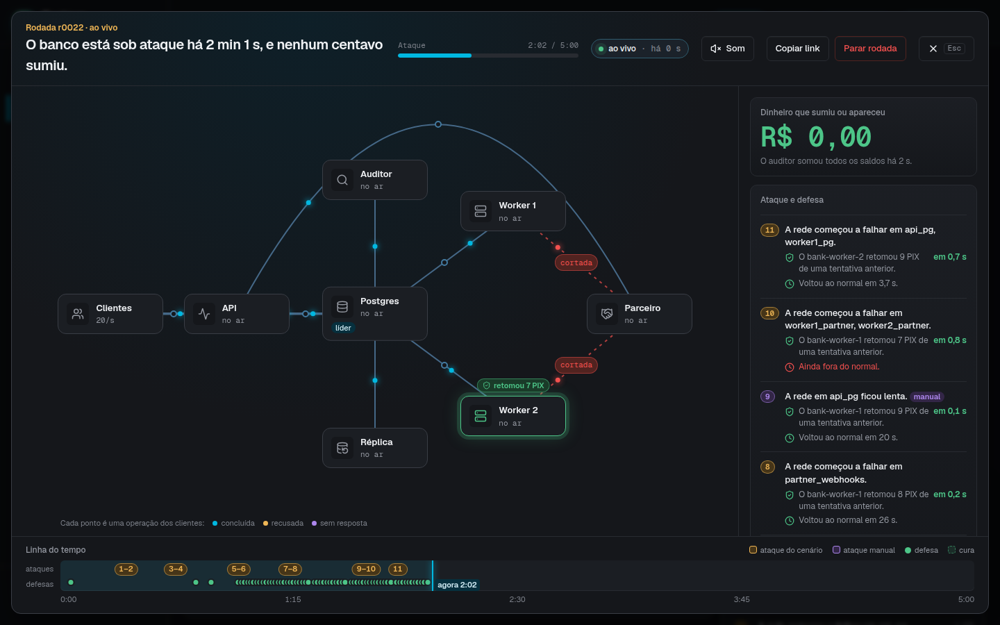

A rodada abre em tela cheia. O mapa mostra os processos do sistema e as
conexões entre eles, com pontos correndo onde há tráfego. No caminho dos
clientes, cada ponto é uma operação, e a cor diz como ela terminou: azul
concluída, amarelo recusada, roxo sem resposta. Em vermelho fica o que bate
num corte ou num processo caído e volta. A r0027 é do ataque "Rede caindo e
voltando" e caiu no cenário de respostas cortadas no meio. Aos 3 minutos, a
conexão dos clientes com a API está cortada. Quando o banco se defende, o
processo que agiu mostra o que fez: o worker 1 acabou de corrigir uma
divergência com o parceiro.

À direita, o auditor continua em R$ 0,00. Embaixo dele, cada ataque aparece
com a primeira defesa que veio depois e o tempo até o alvo voltar ao normal.
No ataque 9, a conexão da API com o Postgres falhou; o worker 2 assumiu o
lease do conciliador 2,7 segundos depois, e a rede voltou em 7,9 segundos. A
linha do tempo, no pé da tela, põe os ataques numa faixa e as defesas em
outra, com a mesma numeração do lado direito. Os ataques manuais ficam em
roxo.

## Ataque manual

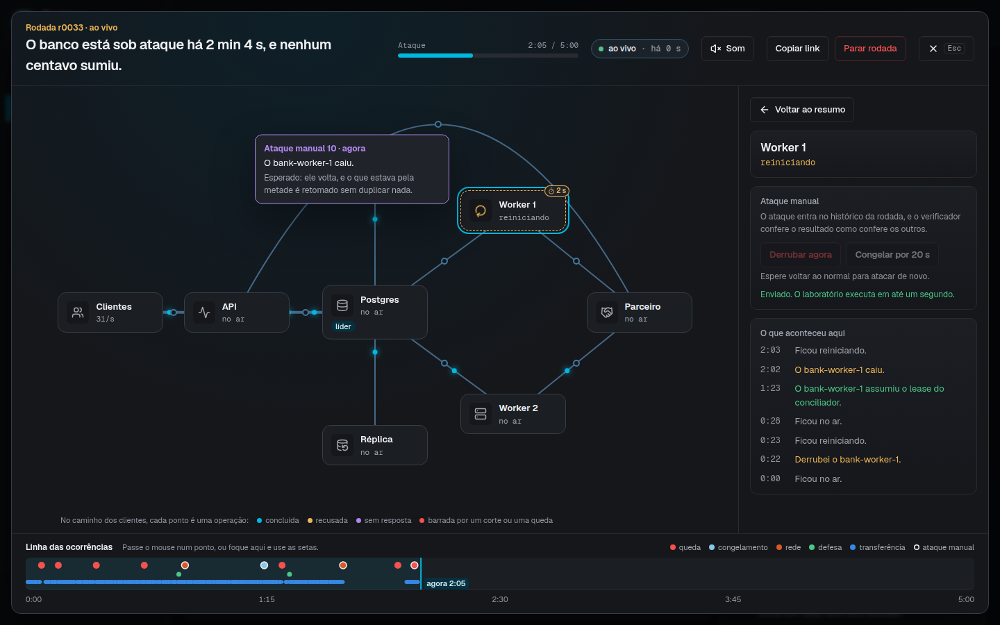

Enquanto dura a fase de ataque, dá para atacar à mão. Um clique num processo
ou numa conexão abre o que aconteceu ali e os botões: derrubar o processo,
congelá-lo por 20 segundos, cortar a conexão por 15 ou deixá-la lenta por 20.
Na imagem, o worker 1 acabou de cair no ataque manual 8. Ele está
reiniciando há 1 segundo, e os botões só voltam quando ele estiver de pé. O
histórico ao lado mostra o que o worker 1 fez antes: assumiu o lease do
conciliador e retomou PIX de tentativas anteriores. A r0027 teve cinco
ataques manuais, e o verificador conferiu a rodada como confere as outras. O
relatório conta esses ataques à parte, porque a semente repete os ataques do
cenário, mas não os feitos à mão.

## O veredito

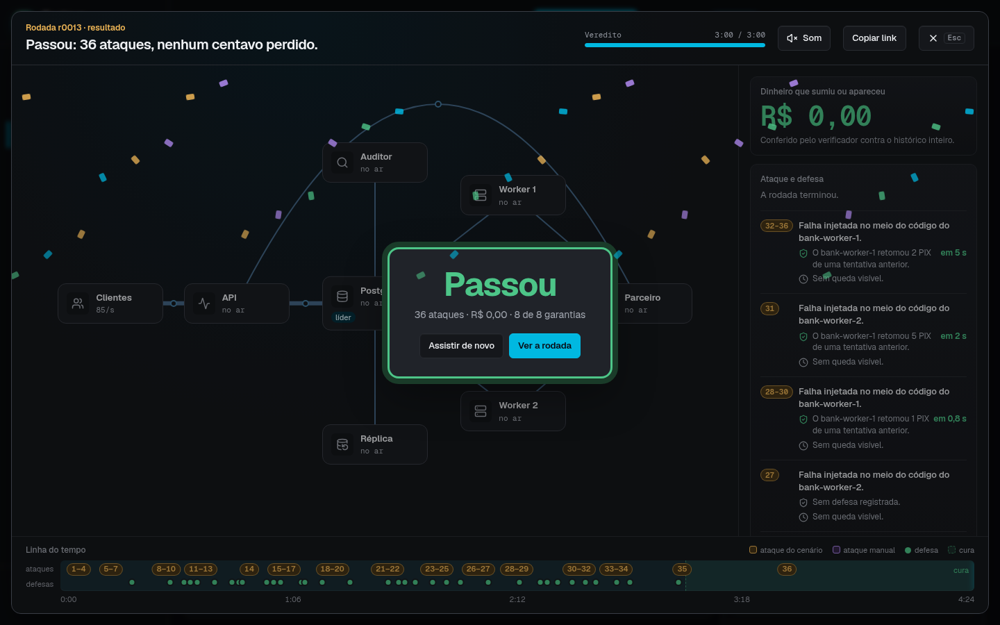

Quando o verificador termina, o veredito cai na arena. A r0013 levou 36
falhas injetadas no meio do código, e o banco respondeu com 34 defesas
registradas: entregas retomadas por outro worker, respostas repetidas tiradas
da chave de idempotência. Os pontos verdes da linha do tempo são essas
defesas. No ataque 31, uma falha no meio do código do worker 2, o worker 1
retomou 5 PIX 2 segundos depois. Daqui dá para assistir de novo ou abrir a
página da rodada.

## O replay

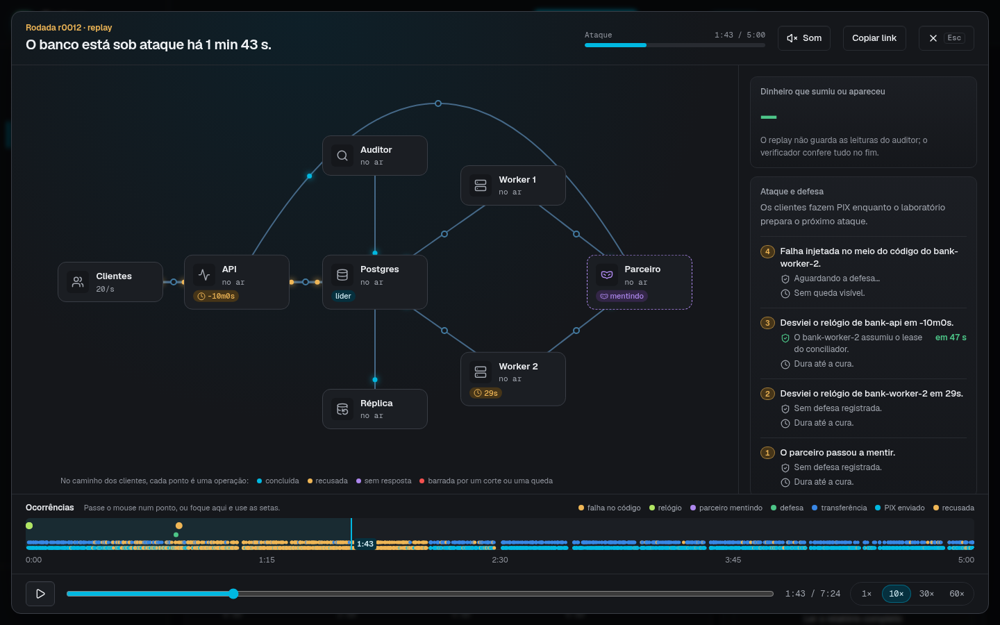

Qualquer rodada terminada pode ser tocada de novo na arena, a 1, 10, 30 ou 60
vezes a velocidade real, com uma barra para ir a qualquer momento. O link
guarda o momento (`?t=1:44`), então dá para mandar alguém direto para o
ataque que interessa. O replay não tem as leituras do auditor, e o cartão do
dinheiro diz isso em vez de mostrar um valor.

## A página da rodada

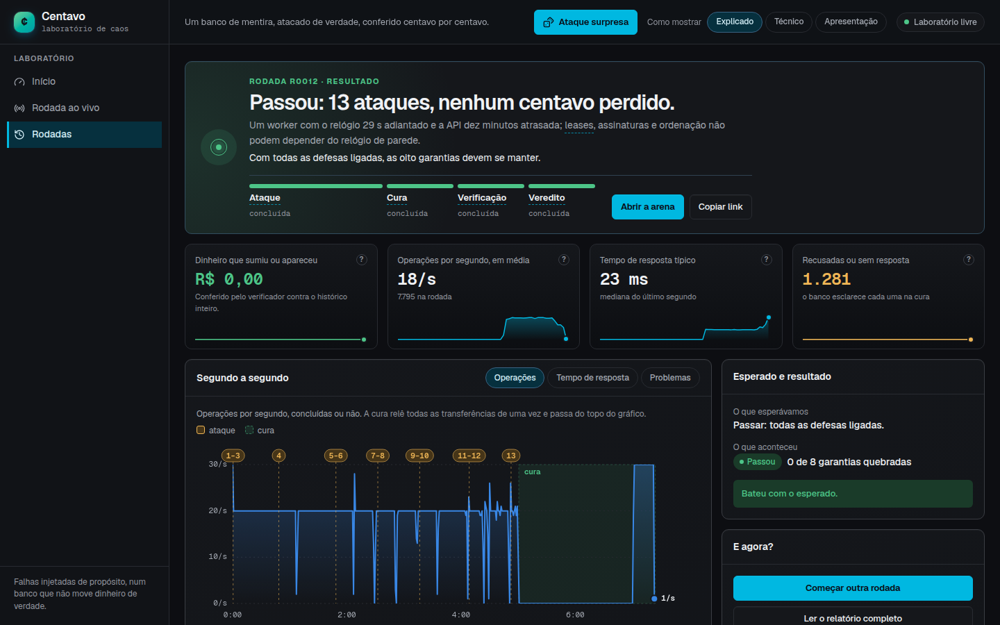

A página explica a rodada em uma frase e mostra as quatro fases: ataque, cura,
verificação e veredito. Os cartões resumem o dinheiro, as operações por
segundo, o tempo de resposta e as operações recusadas ou sem resposta. No
gráfico, os ataques aparecem numerados no alto e a cura fica sombreada. Ao
lado, o que se esperava da rodada (com todas as defesas ligadas, passar) e o
que aconteceu.

## Garantias e linha do tempo

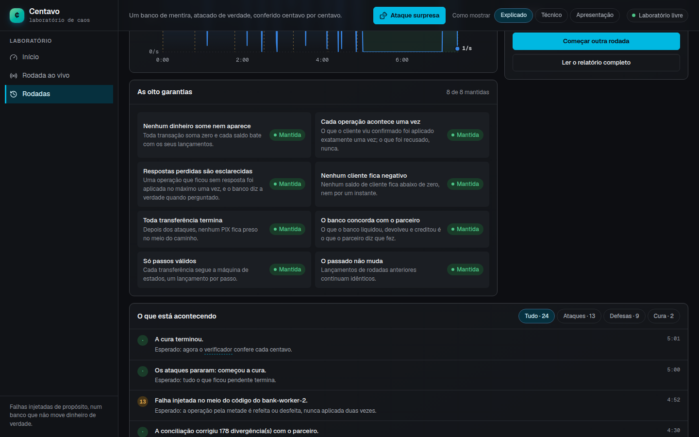

Mais abaixo ficam as oito garantias que o verificador conferiu, cada uma
explicada em uma frase, e a linha do tempo da rodada. Os filtros separam
ataques, defesas e cura. Na r0012, a conciliação corrigiu 178 divergências
com o parceiro, que mentia de propósito.

## Glossário

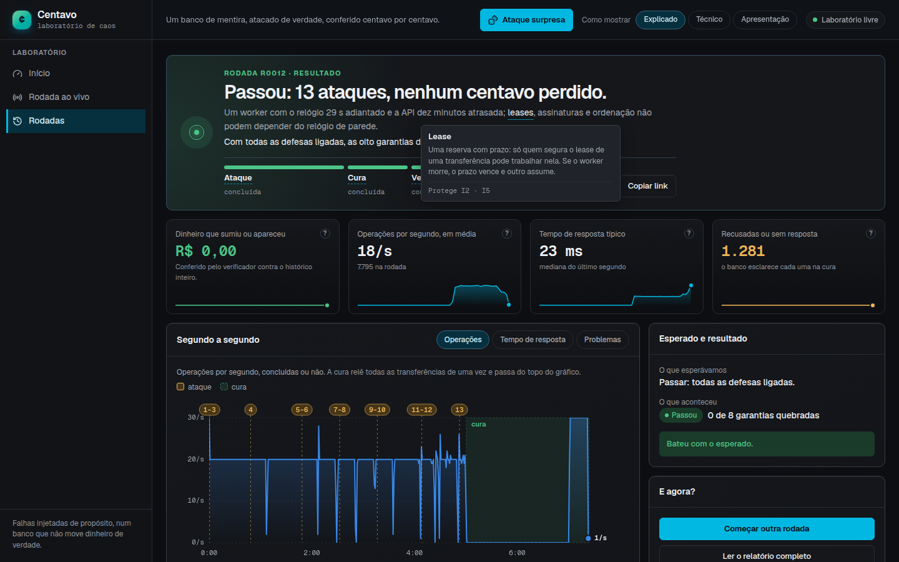

Termos técnicos aparecem sublinhados. Passar o mouse ou focar com o teclado
abre a explicação e a lista das garantias que aquele mecanismo protege.

## Modo técnico

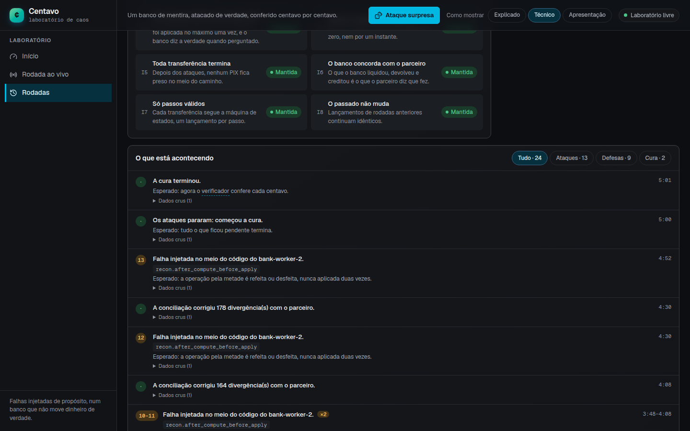

O seletor "Como mostrar" troca a linguagem do painel. No modo técnico, as
garantias ganham os códigos do verificador (I1 a I8) e cada evento mostra o
nome do failpoint que disparou, como `recon.after_compute_before_apply`, e o
registro cru do histórico.

## Modo Apresentação

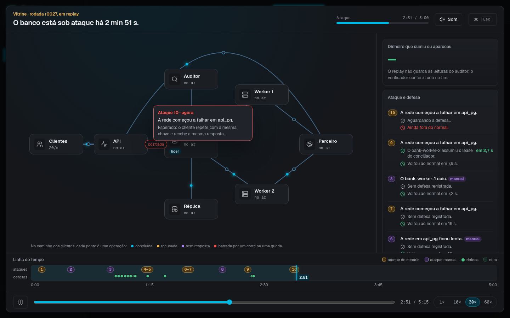

No modo Apresentação, a rodada ao vivo abre direto na arena. Com o laboratório
livre, a página ao vivo vira uma vitrine que toca a rodada aprovada mais
recente em loop, a 30 vezes a velocidade real. Esse modo nunca começa uma
rodada sozinho.

## No celular

  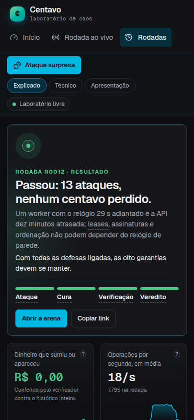
  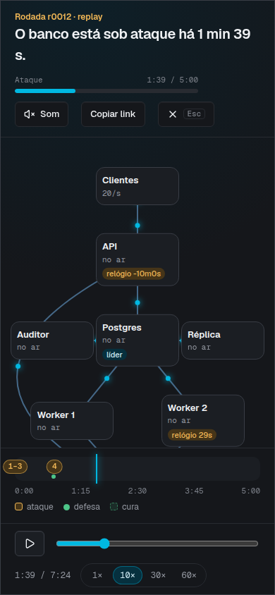

O painel funciona numa tela de 390 pixels. No celular, o mapa da arena gira e
passa a correr de cima para baixo.
